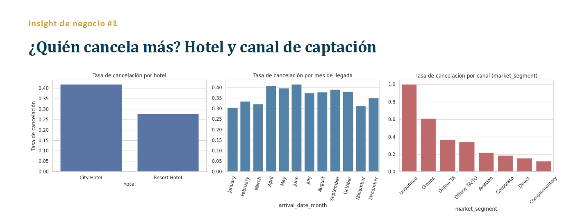
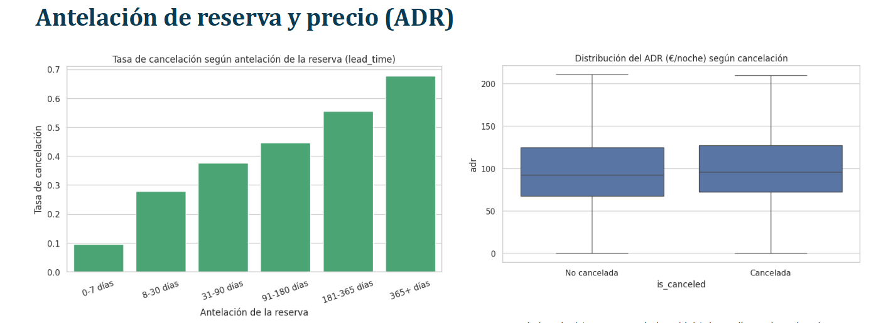
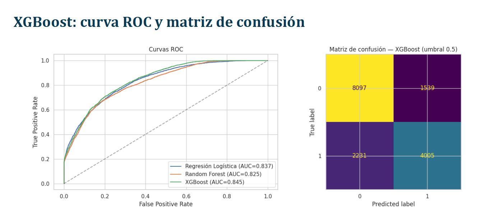
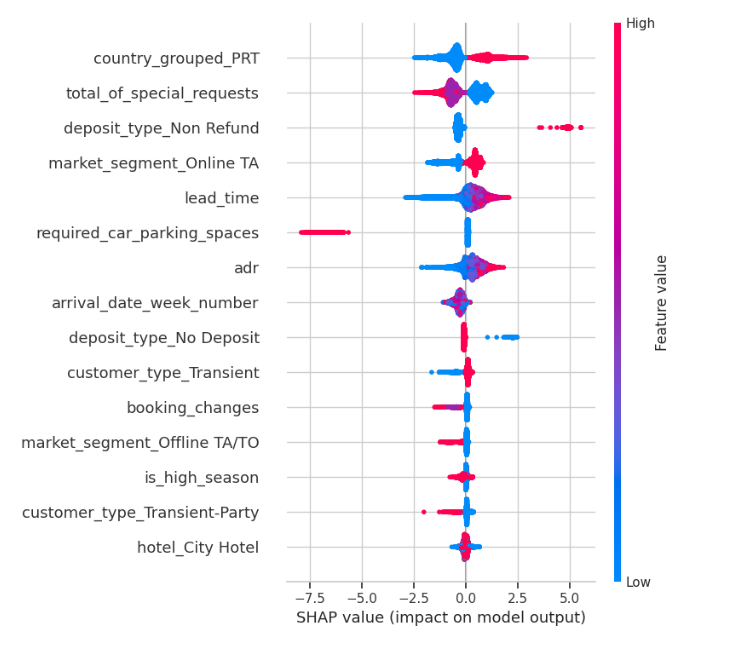
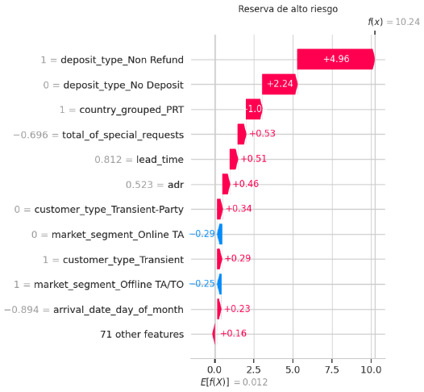
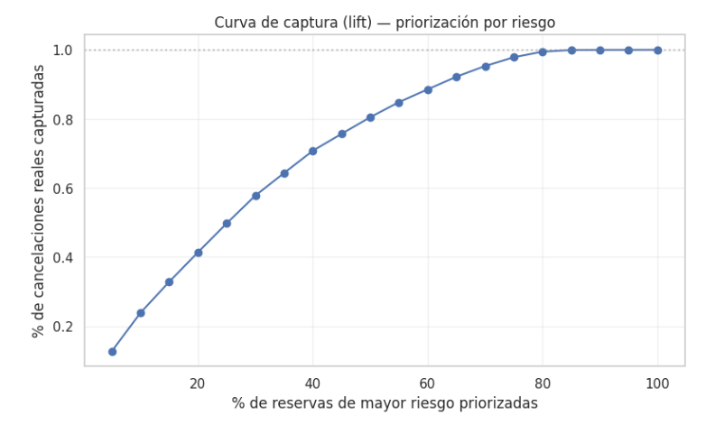

# 🏨 Predicción de Cancelación de Reservas Hoteleras

Modelo de **Machine Learning** para anticipar, en el momento de la reserva, qué clientes tienen alta probabilidad de cancelar, y así activar acciones preventivas de **Revenue Management**.

> Proyecto del Máster en Data Science & IA (Evolve Academy).

## 📌 Problema de negocio

Una cadena hotelera con dos propiedades en Portugal (City Hotel y Resort Hotel) necesita anticipar las cancelaciones para:

- Ofrecer **upgrades con descuento** a clientes de bajo riesgo.
- Solicitar **depósito no reembolsable** de forma selectiva en reservas de alto riesgo.
- Ajustar la **política de overbooking** y evitar habitaciones vacías de última hora.

**El coste de los errores no es simétrico:** un falso negativo deja una habitación vacía a precio de coste, mientras que un falso positivo provoca una acción preventiva innecesaria y un cliente fiel molesto.

## 📊 Dataset

- **Fuente:** Hotel Booking Demand Dataset (Antonio, Almeida & Nunes, 2019)
- **Registros:** 119.210 reservas tras la limpieza
- **Periodo:** julio 2015 – agosto 2017
- **Tasa de cancelación:** 37,1 %

### 🚫 Data leakage (excluido sin excepción)

- `reservation_status` y `reservation_status_date`: revelan literalmente el resultado.
- `assigned_room_type`: se define cerca del check-in, después de la reserva (fuga temporal).

### 🧹 Limpieza aplicada

- `children` nulo → 0
- `country` nulo → `"Unknown"`; 177 países agrupados en Top 10 + Other
- 1 registro con `adr` negativo → corregido a 0
- 180 reservas sin huéspedes → eliminadas
- `company` (94 % nulo) → excluida

## 🔍 Insights del análisis exploratorio

- **Hotel:** el City Hotel cancela un 42 % frente al 28 % del Resort.
- **Canal:** Groups (61 %) y Online TA (37 %) cancelan mucho más que Direct (15 %).
- **Antelación (`lead_time`):** de un 9,6 % de cancelación en reservas de última hora a un 67,7 % en reservas con más de 365 días.
- **Precio (`adr`):** apenas discrimina (105,0 € canceladas vs. 100,2 € no canceladas).




## ⚙️ Feature engineering

8 variables nuevas, cada una con justificación de negocio:

| Variable | Justificación |
|---|---|
| `customer_risk_ratio` | % histórico de cancelaciones del propio cliente |
| `booked_via_agent` | Las reservas vía agente son más volátiles |
| `is_high_season` | Julio/agosto concentran reservas especulativas |
| `total_nights` / `total_guests` | Estancias largas y grupos implican mayor compromiso |
| `is_family` | Viajes familiares, planificados y menos flexibles |
| `country_grouped` | Top 10 países + Other, evita sobreajuste por cardinalidad |

## 🧪 Metodología

**Partición temporal, no aleatoria:** un split aleatorio filtraría información del futuro hacia el pasado. Se entrena con la historia y se evalúa sobre reservas futuras, que es el escenario real de producción.

| | Reservas | Cancelación |
|---|---|---|
| **Train** (jul 2015 – jun 2017) | 103.338 | 36,7 % |
| **Test** (jun 2017 – ago 2017) | 15.872 | 39,3 % |

- **Features tras encoding:** 82 (9 categóricas + 23 numéricas)
- **Desbalanceo:** gestionado con `class_weight` / `scale_pos_weight`
- **Enfoque:** baseline interpretable → modelos más potentes, solo si superan el baseline

## 🏆 Resultados

| Modelo | AUC-ROC | F1 | Precision | Recall |
|---|---|---|---|---|
| Regresión Logística (baseline) | 0.837 | 0.696 | 0.667 | 0.728 |
| Random Forest (tuned) | 0.825 | 0.662 | 0.735 | 0.601 |
| **XGBoost (Optuna)** | **0.845** | 0.680 | 0.722 | 0.642 |

**XGBoost** optimizado con **Optuna** gana en AUC-ROC, la métrica más robusta frente al desbalanceo y que no depende de un umbral fijo.

**Hiperparámetros óptimos:** `n_estimators=225`, `max_depth=8`, `learning_rate=0.145`, `subsample=0.84`, `colsample_bytree=0.66`, `scale_pos_weight=1.72`



## 🧠 Interpretabilidad con SHAP

Variables con mayor importancia media (|SHAP|):

1. `country_grouped_PRT` (cliente portugués)
2. `total_of_special_requests` (a menos peticiones, más riesgo)
3. `deposit_type_Non Refund`
4. `market_segment_Online TA`
5. `lead_time`
6. `required_car_parking_spaces` (factor protector)
7. `adr`



### 💡 Hallazgo más interesante

Un depósito **"Non Refund"** es uno de los mayores impulsores hacia **mayor** probabilidad de cancelación, no menor. En este dataset, esas reservas se corresponden más con bloqueos masivos de agencias/mayoristas que se cancelan en bloque que con clientes individuales comprometidos con una tarifa no reembolsable.

Una regla ingenua (*"depósito no reembolsable = cliente comprometido = bajo riesgo"*) sería errónea con estos datos. La interpretabilidad evita construir intuiciones de negocio equivocadas.



## 🎯 De un umbral fijo a una lista de prioridades

El umbral óptimo por coste marca casi todo como riesgo, lo que lo hace inviable operativamente. La propuesta es **priorizar por percentil de score**:

| Reservas priorizadas por riesgo | Cancelaciones reales capturadas |
|---|---|
| Top 20 % | 41 % |
| Top 30 % | 58 % |
| Top 50 % | 81 % |

El equipo puede dimensionar su lista de trabajo según su capacidad operativa real.



## 📈 Propuesta de negocio

- **Top 20-30 % por score:** contacto proactivo para confirmar la estancia. Si es reserva directa, valorar depósito; si viene de agencia/grupo, renegociar las políticas de bloqueo y cancelación en origen.
- **Franja de riesgo medio:** incentivar peticiones especiales y upgrades con descuento, que aumentan el compromiso del cliente.
- **Overbooking estacional:** ajustar la política del City Hotel en temporada alta (jul-ago).

## 🔭 Próximos pasos

1. Recalibrar el coste de FN/FP con cifras reales de Revenue Management.
2. Monitorizar el modelo en producción y reentrenar periódicamente (drift estacional y de canal).
3. Incorporar variables externas: precios de la competencia, eventos locales, climatología.
4. Evaluar un modelo específico por hotel.

## 🛠️ Tecnologías

`Python` · `Pandas` · `NumPy` · `Scikit-learn` · `XGBoost` · `Optuna` · `SHAP` · `Matplotlib` · `Seaborn` · `Jupyter Notebook`

## 🚀 Cómo ejecutarlo

```bash
git clone https://github.com/Potenjr/Cancelacion_Reservas_hoteleras_MachineLearning.git
cd Cancelacion_Reservas_hoteleras_MachineLearning
pip install -r requirements.txt
jupyter notebook hotel_cancelaciones_prediccion.ipynb
```

## 📁 Estructura del proyecto

```
├── hotel_cancelaciones_prediccion.ipynb   # Análisis, modelado e interpretabilidad
├── reservas_hoteleras.csv                 # Dataset
├── Reservas_Hotel-AdrianPotenciano_presentacion.pdf
├── images/                                # Gráficos usados en el README
├── requirements.txt
└── README.md
```

## 👤 Autor

**Adrián Potenciano Vila** · [GitHub](https://github.com/Potenjr)
